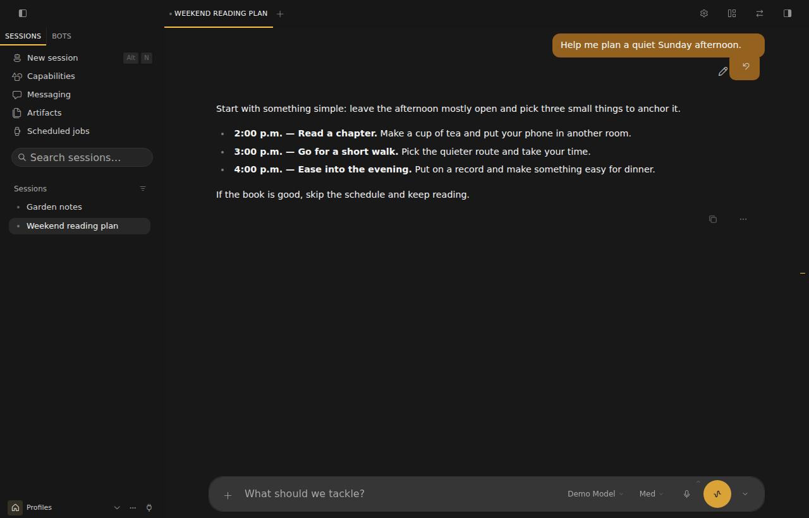
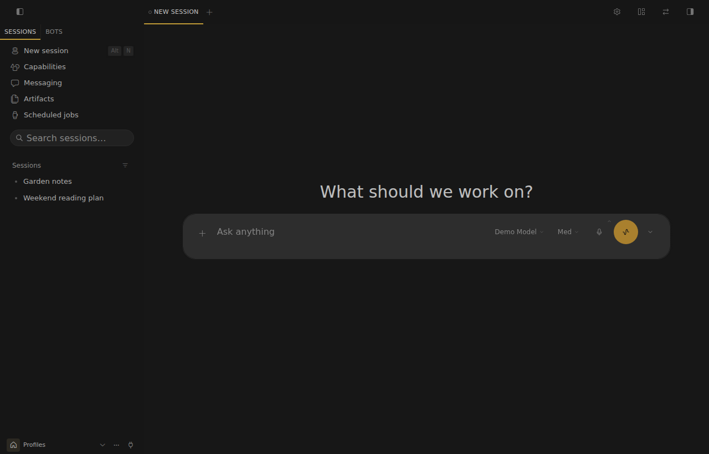

# Graphite Amber

A dark skin for Hermes Agent with charcoal surfaces, warm amber controls, and ochre message bubbles. In Hermes Desktop and Webapp it also refines the chat layout, centers the composer in a new chat, and marks running sessions with an amber badge.

## Screenshots

Captured in Hermes Webapp using fictional demo sessions.





## Install

### Ask Hermes to set it up

Paste this into a Hermes chat to install and activate Graphite Amber:

```text
Install and activate the Graphite Amber theme for my current Hermes profile.
Download the YAML from:
https://github.com/HamadTheIronside/hermes-graphite-amber/releases/download/v0.1.0/graphite-amber.yaml

Save it as graphite-amber.yaml in that profile's skins directory. If I'm using
Webapp or a remote gateway, use the Hermes home on the gateway host. Don't
overwrite a different file with the same name without asking me first. Run
hermes skin use graphite-amber in the same profile and verify it's active.
If Desktop or Webapp doesn't switch automatically, tell me how to select it
in Appearance. Leave my other settings alone and tell me how to switch back.
```

### Install manually

From this repository, run the following on the machine that runs Hermes (the gateway host if you use Webapp or connect Desktop to a remote gateway). For a named profile, use that profile's Hermes home and run the command in the same profile context.

```sh
skin_dir="${HERMES_HOME:-$HOME/.hermes}/skins"
mkdir -p "$skin_dir"
cp graphite-amber.yaml "$skin_dir/"
hermes skin use graphite-amber
```

In Desktop, you can also select `graphite-amber` in **Settings → Appearance**. Use dark mode for the full look. To switch back, run `hermes skin use default` in the same profile or select another theme in Appearance.

## Compatibility

- The palette is a Hermes skin; the layout overrides target the dark Desktop and Webapp interface, not the separate admin dashboard.
- No Hermes core changes are required.
- The CSS targets Hermes renderer markup. If an update changes that markup, some layout refinements may need updating.

## License

[MIT](LICENSE)
